<div align="center">



<br><br>

I build **end-to-end infrastructure products** for email, security and SEO —<br>
from the server to the interface, from the API to the deployment.

<br>

[](https://talhaselcuksezgin.com)
[](https://devtools.com.tr)
[](https://discord.com/users/277501063538409472)
[](https://linkedin.com/in/talha-sel%C3%A7uk-sezgin-95b429332)
[](mailto:info@talhaselcuksezgin.com)

<br>


</div>

<div align="center"></div>

<div align="center">

[**ABOUT**](#-about-me)　·　[**SERVICES**](#-what-i-do)　·　[**BUILDING**](#-currently-building)　·　[**STACK**](#-tech-stack)　·　[**PROJECTS**](#-other-projects)　·　[**CONTACT**](#-get-in-touch)

</div>

## ✦ About Me

<table>
<tr>
<td width="62%" valign="top">

I've been building web products, server infrastructure and automation tools since **2022**. Today my focus is on **infrastructure products that carry real traffic**: business email, DNS/WAF security and SEO analysis.

I care about **clean architecture**, **performance**, **security** and **zero-downtime deployments**. I like owning a product end to end — from provisioning the server to polishing the last pixel of the interface.

> 🟢 **Currently:** actively building **İletora**, **Serpium** and **Vardwall**.

</td>
<td width="38%" valign="top">

```yaml
name:     Talha Selçuk Sezgin
role:     Full Stack Developer
          System Architect
since:    2022
focus:
  - Business email
  - DNS & WAF security
  - AI-powered SEO
stack:    [Go, Next.js, TypeScript,
           PostgreSQL, Docker, Nginx]
hosting:  Verinox
```

</td>
</tr>
</table>

## ✦ What I Do

| `01` Web & Product | `02` Systems & Automation | `03` Gaming & Community |
|---|---|---|
| Full Stack Development | API Development | Minecraft Development |
| E-Commerce Solutions | System Architecture | Discord Bot Development |
| UI/UX & Responsive Design | Automation & Scripting | Community Systems |
| Performance & SEO | Database Management | Custom Integrations |

## ✦ Currently Building

<div align="center">

<a href="https://iletora.com"></a>
<a href="https://serpium.com.tr"></a>
<a href="https://vardwall.com"></a>

</div>

## ✦ Tech Stack

<div align="center">

#### Web & Application


<br><br>

#### Data & Infrastructure


<br><br>

`Discord.js` · `REST API` · `JDA` · `Bukkit` · `Spigot` · `Paper` · `Velocity` · `Mineflayer` · `Postfix` · `Dovecot`

</div>

<div align="center"></div>

## ✦ Other Projects

<div align="center">

<a href="https://19-05-1881.com.tr"></a>
<a href="https://devtools.com.tr"></a>
<a href="https://deryacrafthouse.com.tr"></a>

</div>

## ✦ Certificates

| Institution | Certificate | Year |
|:---:|---|:---:|
| **BTK Akademi** | [Website Usability](https://www.btkakademi.gov.tr/portal/certificate/validate?certificateId=qKrheY9KGK) | `2025` |
| **BTK Akademi** | [Design-Driven Content Creation for Social Media](https://www.btkakademi.gov.tr/portal/certificate/validate?certificateId=O2kkfw1o7mZ) | `2026` |

<div align="center"></div>

## ✦ GitHub Activity

<div align="center">






<br><br>

<picture>
  <source media="(prefers-color-scheme: dark)" srcset="https://raw.githubusercontent.com/talhaselcukk/talhaselcukk/output/snake-dark.svg" />
  <source media="(prefers-color-scheme: light)" srcset="https://raw.githubusercontent.com/talhaselcukk/talhaselcukk/output/snake-light.svg" />
  
</picture>

<br><br>


</div>

## ✦ Hosting Sponsor

<div align="center">

<a href="https://www.verinox.com.tr">
  <picture>
    <source media="(prefers-color-scheme: dark)" srcset="./assets/verinox-logo-white.png" />
    <source media="(prefers-color-scheme: light)" srcset="./assets/verinox-logo.png" />
    
  </picture>
</a>

<br><br>

My projects are proudly hosted on **[Verinox](https://www.verinox.com.tr)** — NVMe web hosting, VDS servers and domains with 24/7 support.

</div>

---

<div align="center">

## ✦ Get in Touch

### Let's build something production-ready together.

[](https://talhaselcuksezgin.com)
[](https://discord.com/users/277501063538409472)
[](mailto:info@talhaselcuksezgin.com)

<br><br>


</div>
